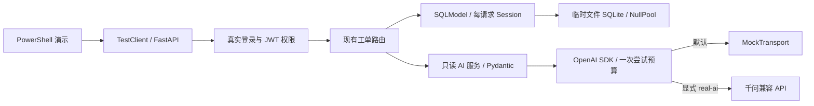

# AI 客服工单分析平台 · FastAPI 后端演示

基于 [fastapi/full-stack-fastapi-template](https://github.com/fastapi/full-stack-fastapi-template) 二次开发的个人工程实践项目，围绕“工单管理 → AI 建议 → 人工判断”构建可复现的后端链路。

当前已实现权限隔离的工单 CRUD、只读 AI 分析，以及无需 Docker/PostgreSQL 的完整 HTTP 演示。AI 建议不自动修改工单，也不执行支付查询、退款或会员开通。独立审核流程、工单前端和生产部署验收尚未完成。

## 项目来源、原作者与许可证

- 上游项目：[Full Stack FastAPI Template](https://github.com/fastapi/full-stack-fastapi-template)，由 Sebastián Ramírez（[tiangolo](https://github.com/tiangolo)）及社区维护。
- 原始版权声明：`Copyright (c) 2019 Sebastián Ramírez`，依据仓库 [LICENSE](LICENSE)。保留原始 MIT 许可和版权文本，LICENSE 未修改。
- 本项目是在该模板上的增量开发；认证、用户系统、原有 Items、React 界面等来源于上游，个人新增贡献列于下表。新增代码按本仓库 MIT 许可证提供。

## 实际新增贡献

| 范围 | 增量工作 | 边界 |
| --- | --- | --- |
| V1：工单管理 | Ticket 模型、创建/列表/详情/PATCH/删除、owner/管理员权限、分页 count 隔离、状态流转、Alembic 迁移 | 保留上游 JWT、用户和 Items；真实 PostgreSQL 仍待验收 |
| 事务测试 | tmp_path 文件 SQLite、NullPool、每请求独立 Session、请求后新连接持久性验证 | commit→flush 故障注入能够检出未提交写入；不等于 PostgreSQL 并发验证 |
| V2：AI 建议 | `POST /api/v1/tickets/{ticket_id}/ai-analysis`；OpenAI Python SDK 对接千问，Pydantic 输出验证，超时/限流/缺密钥/错误 JSON 处理 | 先鉴权再推理；仅返回建议；不新增 AI 数据表、不自动写回 |
| 回复事实边界 | System Prompt 明确没有订单/支付/会员数据库查询结果，禁止编造核实、操作、进度及时效承诺 | Prompt 和结构校验都不能保证事实准确，仍需人工审核 |
| HTTP 业务演示 | 真实登录/JWT、建单、查询、AI 分析、再次查询和新连接不变性检查 | 只在模型 HTTP 传输边界默认 Mock；真实模式必须显式开启 |
| 演示安全与质量记录 | 临时数据库清理、凭据脱敏、一次模型尝试预算、禁重试/重定向、可疑回复质量失败记录 | 质量规则仅用于演示，有误报/漏报，不改变产品 API |

开发里程碑：V1 本地提交 `04811f5`；V2 本地提交 `f05d73f`。演示与本 README 的提交另见 Git 历史。

## 技术栈

| 层次 | 技术与状态 |
| --- | --- |
| 开发环境 | Python 3.14、uv、Windows PowerShell / VS Code |
| API 与认证 | FastAPI、上游 JWT / OAuth2 登录、密码哈希 |
| 模型与验证 | SQLModel、Pydantic、Alembic |
| 数据库 | PostgreSQL 为原模板目标数据库；本地离线测试/演示只用隔离 SQLite |
| AI 适配 | OpenAI Python SDK 2.54.0、千问 OpenAI 兼容 API、JSON 输出及 Pydantic 校验 |
| 自动验证 | pytest、TestClient、HTTPX MockTransport、Ruff、mypy、ty |
| 上游保留部分 | React / TypeScript / Vite、Tailwind CSS、用户/Items 前端及原有部署资源；本阶段没有开发工单前端 |

依赖以 [backend/pyproject.toml](backend/pyproject.toml) 和 [uv.lock](uv.lock) 为准。

## 架构与数据流



这是演示链路，不连接原应用数据库。AI 路由鉴权后仅提取标题/描述快照，结束只读事务、释放连接再推理。返回 `category`、`summary`、`suggested_priority`、`suggested_reply`；工单原始字段通过 HTTP 和全新连接双重核对，保持不变。

## 无需 Docker 的 PowerShell 演示

从仓库根目录安装锁定后端依赖并进入 backend：

```powershell
uv sync --frozen --package app --group dev
Set-Location backend
[Console]::OutputEncoding = [System.Text.UTF8Encoding]::new()
uv run --frozen --package app python -X utf8 scripts/demo_ticket_ai.py
$LASTEXITCODE
```

默认无需模型密钥。即使终端配置了真实密钥，也只使用 MockTransport；不会偷偷切换为真实调用。每次运行创建并清理自己的文件 SQLite，NullPool 保证新物理连接，五个 HTTP 请求各有独立 Session；不会迁移或清理已有数据库。

实际 Mock 链路状态：登录 **200** → 建单 **201** → 查询 **200** → AI 分析 **200** → 再次查询 **200**。输出包括四个 AI 字段、Pydantic 结果、质量标记、全部 7 个原工单字段的不变性和临时库清理结果。密钥、JWT、密码、请求头和上游异常原文不写入运行输出。

- [完整脱敏 Mock 输出](docs/ticket-ai-demo.mock.json)：`mode=mock`、`real=0`、工单未变、临时库已删除。
- [完整后端演示说明](backend/README.md)：实现边界、退出码与护栏。
- 退出码 **0**：链路及不变性通过、规则未发现风险措辞；**1**：链路/结构/不变性失败；**2**：可疑回复被记录为 `quality_failed`。

### 可选：显式真实千问演示

仅在决定进行真实请求时，在已配置 `DASHSCOPE_API_KEY` 的同一终端、backend 目录中单独执行：

```powershell
uv run --frozen --package app python -X utf8 scripts/demo_ticket_ai.py --real-ai
```

每个演示进程最多一次真实 HTTP 尝试，SDK/传输层不重试、不跟随重定向；失败不补发。重复执行命令是新的尝试。缺少密钥时不发送请求。模型、地址、超时配置见 [V2 说明](docs/tickets-v2.md)，输出 Token 上限沿用服务层的 1500。

仓库继承了上游已跟踪的 `.env`，请勿把真实密钥写入或提交到该文件；使用进程环境或私有配置。`.gitignore` 不能自动移除已跟踪文件，也不能清理 Git 历史。

## 测试证据：三种验证必须区分

以下为 **2026-10-26** 本地记录，不代表 GitHub Actions 或生产验收结果。

| 证据 | 已验证内容 | 不能据此声称 |
| --- | --- | --- |
| Mock HTTP 业务演示 | 五步 HTTP 链路、真实 JWT、SQLite 持久性与不变性、SDK/Prompt/结构校验、模型尝试预算 | 真实模型质量或 PostgreSQL 行为通过 |
| 真实千问服务调用 | 根据用户联调反馈，曾通过现有服务层调用一次真实千问，四字段通过 Pydantic | 完整 HTTP 演示的真实模式已运行，或回复事实准确 |
| PostgreSQL 集成测试 | **未执行，58 项跳过** | 数据库迁移、锁、事务隔离或原用户/Items PostgreSQL 回归已通过 |

全量离线结果：**169 passed、58 skipped**，其中演示新增 **13 项**。Ruff/格式检查通过，mypy 检查 **28 个文件**、ty 通过；一条锁定 Starlette TestClient 的弃用警告保留。

在 backend 目录复验：

```powershell
uv run --frozen --package app pytest -q --tb=short
uv run --frozen --package app ruff check .
uv run --frozen --package app ruff format app conftest.py tests_offline tests/conftest.py scripts/test_backend.py scripts/demo_ticket_ai.py --check
uv run --frozen --package app mypy app scripts/test_backend.py scripts/demo_ticket_ai.py tests_offline/conftest.py tests_offline/test_tickets.py tests_offline/test_ticket_ai.py tests_offline/test_ticket_demo.py
uv run --frozen --package app ty check app scripts/test_backend.py scripts/demo_ticket_ai.py tests_offline/conftest.py tests_offline/test_tickets.py tests_offline/test_ticket_ai.py tests_offline/test_ticket_demo.py
```

没有宣称 GitHub CI 通过或当前整体覆盖率达到 90%；CI 门槛未降低，覆盖率排除未扩展。V1 文档中的历史离线覆盖率不是当前全项目验收结果。

## 已知限制

- **SQLite 演示不能替代 PostgreSQL 验收。** 真实迁移链、UUID/时区/约束差异、级联、并发行锁和原 58 项集成测试仍需可丢弃的专用测试库验证。
- 一次真实千问服务调用已暴露“已核实支付、5分钟生效、人工开通”等虚假承诺。已加强 Prompt；新版 Prompt 的真实生成效果和稳定性未再验证。
- Pydantic 校验结构，不校验事实。演示的中文质量规则可能误报/漏报；`no_flags` 不是正确性保证。AI 建议需要人工审核，不能作为支付或权益状态证明。
- 系统没有订单、支付、会员开通查询/执行工具，也没有独立审核工单流程、自动处置、工单前端或生产负载验收。
- V1 授权前行锁 Low 加固项、真实限流/超时表现和完整 CI 覆盖率仍待验证。测试使用 Mock 的真实模式护栏，不计为真实千问联调。

## 发布到个人 GitHub Fork：安全方案

先检查 `git remote -v`，确认每个 fetch/push 目标。建议保留 Fork 关系和 Git 历史：

1. 在个人 GitHub 账户 Fork 上游项目，核对个人账户、仓库 URL 和可见性；不要使用官方仓库作为 push 目标。
2. 把官方远程命名为 `upstream`，只用于获取上游更新；将其 push URL 设为不可用地址，例如 `https://example.invalid/blocked-upstream-push`。
3. 将 `origin` 指向核实后的个人 Fork；设置 `remote.pushDefault=origin`，并为当前分支设置 `pushRemote=origin`。
4. 再检查远程地址、待发布文件及历史敏感信息，先对个人 Fork 做指定分支的 `git push --dry-run`。
5. 只有明确决定发布时，才对个人 Fork 执行显式分支推送；不强推、不把功能分支自动合并进主分支。

本轮只制定方案和本地提交，没有创建远程 Fork、改写 remote 或执行任何 push。真实凭据不得写入 URL、README 或命令示例；当前文件扫描也不能替代 Git 历史全量审计。

## 文档与上游资源

- [V1 实现、迁移及学习说明](docs/tickets-v1.md)
- [V2 AI 服务、真实联调问题与可靠性局限](docs/tickets-v2.md)
- [后端与演示](backend/README.md) / [上游前端文档](frontend/README.md)
- [上游开发说明](development.md) / [上游发布记录](release-notes.md)
- [上游 FastAPI Cloud 部署](deployment.md) / [上游自托管部署资料](deployment-docker-compose.md)

上述部署资料是模板保留资源，不表示本项目已经完成部署，也不是离线演示的前置条件。

<details>
<summary>上游模板界面截图（不是本项目新增的工单 / AI 前端）</summary>


</details>
